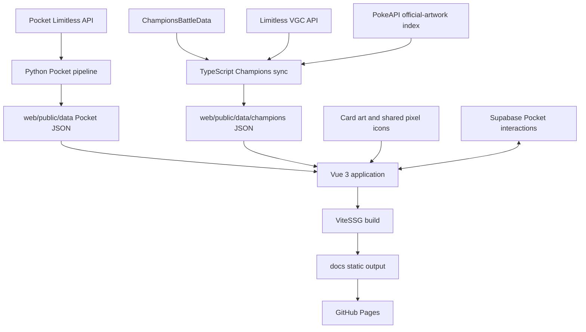

# BattleTowerMeta 專案總覽

> 更新日期：2026-11-06
> 目前 Pocket 遊戲版本：C1 - Dual Fusion（雙重融合）
> 用途：新協作者交接、功能開發，以及大型視覺改版前的共同基準

## 1. 專案定位

BattleTowerMeta 是一個多遊戲競技情報網站。目前首頁 `/` 是 Game Selection Home，兩個完全獨立的資料分區是：

- PTCG Pocket：`/pocket*`
- Pokemon Champions：`/champions*`

Pocket 從 Limitless Tournament Platform 取得公開賽事資料，經 Python pipeline 整理。Champions 同時整合 ChampionsBattleData 與 Limitless VGC 資料，由 TypeScript sync script 產生靜態 cache。兩個分區共用 Vue 3 + ViteSSG shell，最後部署到 GitHub Pages。登入、個人排位記錄、交易與牌組討論等 Supabase 功能目前屬於 Pocket 分區。

BattleTowerMeta 不是單純的勝率排行榜。它同時呈現：

- 牌組 Tier List 與相對分級
- 牌組使用率、Top 32 表現與加權成績
- 勝率矩陣與具體勝、負、和場數
- 熱門牌組排行與牌組詳情
- 最佳範例牌組與卡片投入率
- 泛用卡片圖鑑
- 賽事列表與單場賽事報告
- 玩家排名、玩家履歷與地區排名
- 排位記錄、交易與牌組討論
- 牌組 PNG、Tier List PNG 與創作者素材 ZIP

Pokemon Champions 分區目前提供：

- 對戰環境總覽、寶可夢 Tier 與招式／道具使用率
- 寶可夢排名、官方立繪卡片與寶可夢詳情
- Limitless VGC 隊伍參考與六隻寶可夢像素圖
- 速度線計算器
- 傷害計算器 UI skeleton
- 手動對戰記錄／匯出工具 skeleton

## 2. 目前狀態快照

以下數字為 Pocket 2026-09-03、Champions 2026-07-17 的歷史快照；目前數據請以網站及每日 pipeline 輸出為準：

| 項目 | 目前狀態 |
| --- | ---: |
| 收錄賽事 | 1,655 |
| 全部參賽紀錄 | 330,076 |
| Top 32 樣本位置 | 51,475 |
| 牌組 sprite PNG | 434 |
| 卡片圖 | 3,871 |
| Pocket 歷史快照卡包 | B4a - Team Rocket's Ambition（火箭隊的野心） |
| B4 卡片數 | 233 |
| B4a 卡片數 | 110 |
| Champions 寶可夢 season / format rows | 470 |
| Champions 寶可夢詳情 | 235 |
| Champions 隊伍參考 | 686 |
| Champions 賽事 | 50 |
| Champions 最近同步 | 2026-07-17T08:37:00.473Z |

核心 production URL：

```text
https://www.battletowermeta.com/
```

## 3. 技術棧

| 層級 | 技術 |
| --- | --- |
| Frontend | Vue 3、`<script setup>`、TypeScript |
| Routing | Vue Router |
| Static generation | Vite 7、ViteSSG |
| Data pipeline | Python 3（Pocket）、TypeScript + `tsx`（Champions） |
| Hosting | GitHub Pages |
| CI/CD | GitHub Actions |
| Interactive backend | Supabase |
| 圖片匯出 | `html-to-image` |
| ZIP 產生 | 瀏覽器端 ZIP builder，主要集中於 `DeckProfile.vue` |
| Analytics | Google Analytics |
| Browser QA | Playwright / Codex in-app browser |

前端 package 定義在：

```text
web/package.json
```

## 4. 三層架構



可以把整個專案理解為三層：

1. 資料層：Pocket Python pipeline + Champions TypeScript sync -> runtime JSON
2. 靜態網站層：Vue views -> ViteSSG -> `docs/`
3. 互動層：Supabase auth/tables -> Pocket 排位、交易、討論

大型視覺改版原則上應集中在第二層，避免改動第一層的統計語意與第三層的資料契約。

## 5. Repository 地圖

```text
BattleTowerMeta/
  .github/
    workflows/
      daily.yml                    # 每日資料更新、build、Pages 部署

  scripts/
    fetch_raw_data.py              # 抓取賽事與 raw data
    process_data.py                # 產生全域統計
    build_precomputed_views.py     # 預先計算熱門牌組與牌組詳情
    build_tournament_pages.py      # 產生單場賽事頁 JSON
    extract_tournament_players.py  # 產生賽事玩家資料

  supabase/
    schema.sql                     # Supabase schema、RLS、trigger、view

  web/
    package.json
    scripts/
      sync-champions-data.ts       # Champions 雙來源同步與圖片補齊
    vite.config.ts                 # Vite config，build 到 ../docs
    public/
      data/                        # runtime JSON，由 pipeline 產生
        champions/                 # Champions cache、詳情與 sync status
      fonts/                       # Source Han Sans、D-DIN
    src/
      main.ts                      # ViteSSG 入口、GA、靜態 route discovery
      routes.ts                    # zh/en 路由表
      App.vue                      # 全站 topbar、mobile sidebar、footer
      layouts/Layout.vue           # RouterView 與 html lang
      responsive.css               # 最小全域 responsive reset
      style.css                    # Vite starter 遺留，目前沒有被 main.ts 匯入
      assets/
        theme.css                  # 全域顏色 token 與 body 背景
        fonts.css                  # 字體與字體 token
        champions.css              # Champions 共用 layout 與視覺規則
        pokemonNames.ts            # Pokemon / 牌組名稱本地化
        deck-icons/                # Pocket 牌組與 Champions 寶可夢共用像素圖
        deck-disks/                # 卡片數量 badge 圖
        limitless_dump/            # 卡片 catalog JSON 與 WebP
      components/                  # Supabase 與互動功能元件
        champions/                 # Champions panel、hero、圖片與空狀態
      data/champions/              # API clients、normalize、cache provider/type
      lib/                         # 資料讀取、統計、分級、Supabase
        champions/                 # Champions domain types、i18n、工具計算
      views/                       # Pocket route 頁面
        champions/                 # Champions route 頁面

  docs/                            # build 產物，不要手動修改
  PROJECT_OVERVIEW.md              # 本文件
```

## 6. App 入口與路由

入口流程：

```text
web/src/main.ts
  -> import theme.css / fonts.css / responsive.css
  -> ViteSSG(App, routes)
  -> client 端初始化 Google Analytics
  -> build 時讀 tier.json，加入所有牌組詳情靜態 routes
```

目前 canonical routes 不使用語言前綴；中文是預設語言，英文使用 `?lang=en`。舊 `/zh/*`、`/en/*` 與 Pocket 舊路由仍保留 redirect。

```text
/

/pocket
/pocket/tournaments
/pocket/tournaments/:id
/pocket/top-decks
/pocket/decks/:slug
/pocket/top-cards
/pocket/records
/pocket/players
/pocket/players/:playerSlug
/pocket/countries

/champions
/champions/pokemon
/champions/pokemon/:slug
/champions/teams
/champions/speed
/champions/damage-calculator
/champions/simulator
```

語言、分區與 nav 定義集中於：

```text
web/src/lib/siteI18n.ts
```

`routeSection()` 只會回傳 `home`、`pocket`、`champions`。`App.vue` 依此切換 game nav、ticker 與 footer：首頁不顯示 game nav/ticker；Pocket 顯示 Pocket nav 與 tournament ticker；Champions 顯示 Champions nav 與同步狀態。

目前沒有使用全域 i18n plugin。全站 shell 文案在 `siteI18n.ts`；Champions 頁面文案在 `web/src/lib/champions/i18n.ts`；部分 Pocket 頁面仍把中英文文字放在各 Vue 檔案內。

視覺改版若改動導覽、標題、空狀態或按鈕文字，必須同時檢查預設中文 URL 與 `?lang=en`。

## 7. 主要頁面地圖

### 7.1 PTCG Pocket

| 頁面 | 核心內容 | 視覺改版風險 |
| --- | --- | --- |
| `Home.vue` | 首頁入口、牌組 ZIP、完整素材 ZIP | 會以隱藏的 `DeckProfile` 啟動 creator pack |
| `TierList.vue` | 使用率、Tier lanes、勝率矩陣、PNG 匯出 | sticky matrix、桌面與 mobile 是不同呈現方式 |
| `Tournaments.vue` | 賽事列表、版本與時間篩選 | 資料密度、長列表、mobile table |
| `TournamentReport.vue` | 單場賽事摘要、Top 32 牌表 | 名次、牌組 sprite、報表密度 |
| `TopDecks.vue` | 牌組排名、分級、趨勢與篩選 | 欄位多、桌面 table 與 mobile rows |
| `DeckProfile.vue` | 牌組詳情、範例牌組、投入率、對局、下載 | 全站最複雜頁面，匯出 DOM 與 UI 高度耦合 |
| `TopCards.vue` | 卡片圖鑑、投入率、1 張/2 張比例 | 大量卡圖、篩選器、responsive card grid |
| `PlayerRanking.vue` | 玩家排行榜 | 高密度排名 table |
| `PlayerProfile.vue` | 玩家成績、牌組與賽事履歷 | 多組統計 panel 與時間資料 |
| `CountryRanking.vue` | 地區排行榜 | 國旗、長名稱、mobile 排版 |
| `BattleHub.vue` | 排位記錄與互動功能容器 | 內部主要由 components 負責 |

#### 7.1.1 Pocket 雙牌組支援（2026-11-06）

- `/pocket` 由 `PocketMeta.vue` 提供單／雙牌組切換；雙牌組網址為 `/pocket?deckMode=dual`，英文再加 `&lang=en`。
- `PocketMultiDeckMeta.vue` 呈現牌組登錄佔比、雙牌組搭配、小局勝率、對戰矩陣及資料覆蓋範圍。
- Limitless 官方資料契約：details 的 `multideck`、standings 的 `decks`／`decklists`，以及 pairings 的 `games`。牌組必須按編號對應；以每小局的 `p1deck`／`p2deck` 與 `winner` 歸屬牌組戰績。
- 牌組登錄佔比的分母是已辨識的牌組欄位數，每位選手預期兩副。搭配順序合併，搭配戰績按整場對局計算，Top 32 按選手名次計算。單牌組 Tier／玩家排名仍使用單牌組資料集。
- 沒有小局資料或牌組選擇時不推算牌組勝負；輪空、自動判負與未確定賽果另行排除或標示。兩副牌表在賽事詳情中獨立展示，持續使用 `CardImageWithCount.vue`。
- `scripts/fetch_raw_data.py` 以官方欄位識別並保存雙牌組來源；`scripts/process_data.py` 會把舊索引中的多牌組賽事移到獨立索引。
- 來源索引：`web/public/data/multideck/tournaments.json`；raw 路徑維持 `web/public/data/raw/<id>/`；衍生統計：`web/public/data/multideck/meta.json`。
- 每日 Actions 已加入 `python scripts/build_multideck_views.py`。預設維持 64 人門檻；可使用 `--fetch-id <id>` 補抓指定賽事，只有完整抓取成功才替換來源。超過兩副的賽事不納入此雙牌組環境。
- 雙牌組回補：設定 `DAYS_BACK`、`MIN_PLAYERS` 後執行 `python scripts/fetch_raw_data.py --multideck-only`，再執行 `python scripts/build_multideck_views.py`；回補以官方 metadata 辨識，不依賴賽事名稱。
- 驗證：`python -m unittest discover -s scripts -p test_pocket_multideck.py -v`、`cd web; npx.cmd tsx --test src/lib/pocketMultideck.test.ts`、`npx.cmd vue-tsc -b` 及 production build。

### 7.2 Pokemon Champions

| Route / component | 目前功能 | 完成度與注意事項 |
| --- | --- | --- |
| `/champions` / `ChampionsMeta.vue` | 寶可夢 Tier、隊伍 Tier、寶可夢／招式／道具使用率 | 已接靜態資料；資料列使用像素圖 |
| `/champions/pokemon` / `ChampionsPokemonRanking.vue` | 搜尋、屬性／賽制／賽季篩選、排序、能力值雷達 | 已接 235 種寶可夢；卡片使用 official artwork |
| `/champions/pokemon/:slug` / `ChampionsPokemonProfile.vue` | 基礎能力、招式／道具、隊友、隊伍參考、move pool | 主圖使用 official artwork；隊友使用像素圖 |
| `/champions/teams` / `ChampionsTeams.vue` | 賽季、賽制、寶可夢、來源、成績篩選與隊伍詳情 | 已接 Limitless VGC；每隊使用六張像素圖 |
| `/champions/speed` / `ChampionsSpeed.vue` | Level、性格、EV/IV、能力階級、道具、天氣、Tailwind、Trick Room | 有本機計算，但 `rulesAccuracy` 仍標記為 `skeleton`，只涵蓋目前列出的 modifier |
| `/champions/damage-calculator` / `ChampionsDamageCalculator.vue` | 攻守方、招式與場地輸入 UI | 只有 UI skeleton；`calculateDamage()` 目前固定回傳 `—`，不可宣稱為完整傷害引擎 |
| `/champions/simulator` / `ChampionsSimulator.vue` | 六隻隊伍欄位、逐回合手動記錄、複製文字 | 是手動 battle log，不是規則／AI 對戰模擬器 |

Champions 共用 UI 元件位於 `web/src/components/champions/`。`ChampionsPokemonImage.vue` 是唯一應優先使用的寶可夢圖片入口，會依 `mode` 切換立繪或像素圖並處理 fallback。

## 8. 共用 frontend libraries

`web/src/lib/`：

| 檔案 | 職責 |
| --- | --- |
| `publicData.ts` | cached fetch、raw standings、pairings、runtime JSON |
| `playerEntries.ts` | 玩家資料型別、遊戲版本、時間與 Top Cut filters |
| `pairingResolver.ts` | 對局雙方、牌組與賽果解析 |
| `deckTier.ts` | Tier 分數、EMA 與 SS/SSS 判定 |
| `precomputedViews.ts` | 讀取 Top Decks / Deck Profile 預運算資料 |
| `rankTracker.ts` | 排位升降、連勝與對局記錄計算 |
| `supabase.ts` | Supabase client、登入狀態、profile |
| `interactive.ts` | rank logs、trade posts、deck discussions |
| `countryNames.ts` | 地區名稱本地化 |
| `analytics.ts` | GA 初始化與 page view |

Champions 額外分成兩層：

| 路徑 | 職責 |
| --- | --- |
| `web/src/data/champions/championsBattleDataClient.ts` | ChampionsBattleData HTTP client、timeout、retry、concurrency |
| `web/src/data/champions/limitlessChampionsClient.ts` | 自動辨識 Limitless Pokemon Champions / VGC game，讀取賽事與 standings |
| `web/src/data/champions/championsNormalize.ts` | 外部資料 normalization 與 source asset URL |
| `web/src/data/champions/championsDataProvider.ts` | 只讀本機 `/data/champions/*.json`，提供篩選與 per-file Promise cache |
| `web/src/data/champions/championsCacheTypes.ts` | 生成 cache 的資料契約 |
| `web/src/lib/champions/providers.ts` | cache model 轉成頁面 domain model |
| `web/src/lib/champions/types.ts` | 頁面層 provider interfaces 與 domain types |
| `web/src/lib/champions/images.ts` | `deck-icons` glob、形態 alias 與像素圖解析 |
| `web/src/lib/champions/speed.ts` | 目前有限範圍的速度計算 |
| `web/src/lib/champions/damage.ts` | 傷害計算器契約；目前仍是 skeleton |

Champions 頁面不應直接呼叫外部 API。瀏覽器只讀 build 前產生的靜態 JSON；同步與 normalization 應留在 `npm run sync:champions`。

視覺改版時應盡量保留這些 module 的 public interface。若只是改 layout、顏色與元件外觀，不應同時重寫資料計算。

## 9. 目前視覺系統

### 9.1 全域樣式入口

實際被 `main.ts` 匯入的全域 CSS：

```text
web/src/assets/theme.css
web/src/assets/fonts.css
web/src/assets/champions.css
web/src/responsive.css
```

`web/src/style.css` 是 Vite starter 遺留檔，目前沒有被 `main.ts` 匯入，不應把新設計 token 放進去。

`champions.css` 負責 Champions route 共用 grid、panel、row、Pokemon card、team card、calculator 與 mobile 規則。修改 Champions 視覺時，先檢查這個檔案，再處理個別 route SFC。

### 9.2 現有 design tokens

`theme.css` 目前只有少量 token：

```css
--accent: #00afef;
--accent-hover: #0096cf;
--bg: #071521;
--surface: #0b2235;
--text: #eaf6ff;
--muted: #9fb3c8;
--border: #18364d;
```

目前大量顏色、陰影、圓角、間距和 breakpoint 仍直接寫在各 Vue SFC 裡。

大型視覺改版建議先擴充 token，而不是逐頁換 hard-coded color：

```text
color:
  canvas / surface / elevated / overlay
  text-primary / text-secondary / text-muted
  border-subtle / border-strong
  accent / positive / negative / warning / neutral

space:
  4 / 8 / 12 / 16 / 24 / 32

radius:
  control / panel / card / modal

shadow:
  panel / floating / focus

size:
  page-max / topbar-height / control-height / icon-button
```

### 9.3 字體

字體在 `web/src/assets/fonts.css`：

- 英文 display：Anton
- 中文：Source Han Sans / Noto Sans TC fallback
- 數字：D-DIN Condensed / D-DIN

`.mono` 用於比例、場數、排名與其他需要 tabular numbers 的數字。

視覺改版應保留數字欄位的 tabular alignment，否則排名、勝率與矩陣會變得難以掃讀。

### 9.4 全站 shell

`App.vue` 負責：

- sticky topbar
- desktop navigation
- mobile menu button
- mobile sidebar / overlay
- account menu
- 中英文切換
- 1400px 內容最大寬度
- footer

目前主要 breakpoint：

- `1100px`：縮小 topbar spacing / nav font
- `760px`：隱藏 desktop nav，改用 sidebar

### 9.5 頁面樣式分布

多數頁面使用大型 `<style scoped>`，視覺規則高度分散：

| 檔案 | 約略行數 | 改版注意 |
| --- | ---: | --- |
| `DeckProfile.vue` | 8,700+ | UI、匯出 HTML、ZIP、資料整合全部在同檔 |
| `TierList.vue` | 3,600+ | Tier lanes、matrix、mobile matrix、匯出 |
| `TopCards.vue` | 2,400+ | card atlas 與卡圖 grid |
| `TopDecks.vue` | 2,300+ | desktop/mobile ranking |
| `Tournaments.vue` | 1,600+ | filters、table、mobile |
| `TournamentReport.vue` | 1,400+ | tournament report |
| `PlayerProfile.vue` | 1,400+ | 多種個人統計 panel |

這代表大型改版若直接逐頁覆蓋 CSS，很容易形成更多重複規則。較穩定的方向是先建立共用視覺 primitives，再逐頁替換。

### 9.6 現有 responsive breakpoints

頁面內目前混用：

```text
480 / 520 / 560 / 640 / 680 / 720 / 760
820 / 900 / 980 / 1080
1280 / 1320 / 1380
```

大型改版應整理成少量共享 breakpoint，但不能一次刪掉現有規則。先逐頁確認實際 layout，再合併相近 breakpoint。

## 10. 建議建立的 UI primitives

目前沒有完整共用 design system。視覺改版第一階段可考慮建立：

```text
components/ui/
  AppButton.vue
  IconButton.vue
  AppSelect.vue
  SegmentedControl.vue
  FilterBar.vue
  StatBlock.vue
  DataPanel.vue
  EmptyState.vue
  LoadingState.vue
  DeckIdentity.vue
  TierBadge.vue
  SpriteStack.vue
```

優先抽取條件：

- 至少在三個頁面重複
- 視覺與互動契約一致
- 不把頁面特有的統計邏輯塞進共用元件

不要為了「元件化」一次拆完所有大型頁面。先抽最穩定的視覺單位，例如 button、select、panel header、tier badge、sprite stack。

## 11. 資料 pipeline

### 11.1 PTCG Pocket

```text
1. scripts/fetch_raw_data.py
   -> tournaments.json
   -> raw/<tid>/{details,standings,pairings}.json
   -> excluded_tournaments.json

2. scripts/process_data.py
   -> tier.json
   -> players.json
   -> player_entries.json
   -> matchups.json
   -> meta.json

3. scripts/build_precomputed_views.py
   -> precomputed/top_decks.json
   -> precomputed/deck_profiles/*.json

4. scripts/build_tournament_pages.py
   -> tournament-pages/*.json
   -> tournament-pages/manifest.json

5. scripts/extract_tournament_players.py
   -> tournament_players_final.json

6. cd web && npm run build
   -> docs/
```

`web/public/data/` 是生成資料，不應為了 UI 手動修改。

特殊規則賽事 `6a021c2313f957d6d4b45d8b` 已在以下兩個檔案明確排除：

```text
scripts/fetch_raw_data.py
scripts/process_data.py
```

### 11.2 Pokemon Champions

```text
ChampionsBattleData
  -> Pokemon index、metadata、battle rows、source sprite

Limitless API
  -> 自動辨識 Pokemon Champions / VGC game
  -> tournaments、standings、六隻隊伍與成績

PokeAPI sprites index
  -> official-artwork URL mapping

cd web && npm run sync:champions
  -> public/data/champions/meta.json
  -> public/data/champions/sync-status.json
  -> public/data/champions/pokemon.json
  -> public/data/champions/pokemon-details/*.json
  -> public/data/champions/moves.json
  -> public/data/champions/items.json
  -> public/data/champions/teams.json
  -> public/data/champions/tournaments.json
  -> src/assets/deck-icons/*.png（只補缺少的像素圖）
```

同步入口是 `web/scripts/sync-champions-data.ts`。兩個資料來源會各自記錄 `success`、`partial` 或 `failed`；`sync-status.json` 同時控制 Champions header ticker 與 footer 狀態。單一來源失敗時應保留另一來源可用資料，不要把整個專區改回 hard-coded mock。

目前快照是 470 個 season / format 寶可夢 rows、235 個 detail JSON、715 個招式 rows、279 個道具 rows、686 個隊伍參考與 50 場賽事。

`championsDataProvider.ts` 使用 `cache: "no-cache"` 讀取靜態 JSON；成功 request 會保留 per-file Promise cache，失敗 request 會從 cache 移除以允許重新嘗試。改動 loading 或空狀態時不要破壞這個 retry 行為。

## 12. 牌組分級公式

BattleTowerMeta 的 Tier 是同一篩選範圍內的相對分數，不是單純勝率排名。

### 12.1 原始三項訊號

- 40%：Top 32 次數
- 50%：加權名次分
- 10%：Top 32 占比

名次分：

| 名次 | 分數 |
| --- | ---: |
| 1st | 10 |
| 2nd | 8 |
| 3rd-4th | 6 |
| 5th-8th | 4 |
| 9th-16th | 2 |
| 17th-32nd | 1 |

### 12.2 EMA

目前額外加入 15% EMA 趨勢分：

```text
最終分數 =
  34.0% 標準化 log(Top 32 次數)
  + 42.5% 標準化 log(加權名次分)
  + 8.5% 標準化 log(Top 32 占比)
  + 15.0% 標準化 EMA 趨勢
```

前三項仍維持原本 40:50:10 的內部比例，只是整體縮成 85%，把 15% 留給近期趨勢。

每日 EMA signal：

```text
0.4 * log1p(當日 Top 32 次數)
+ 0.5 * log1p(當日加權名次分)
+ 0.1 * log1p(當日 Top 32 占比)
```

EMA 半衰期是 7 天，可由環境變數調整：

```text
TIER_EMA_HALF_LIFE_DAYS
```

前端與預運算版本必須保持一致：

```text
web/src/lib/deckTier.ts
scripts/build_precomputed_views.py
```

### 12.3 Tier 門檻

| 分數 | Tier |
| --- | --- |
| `<= 0.10` | F |
| `> 0.10` 且 `<= 0.30` | E |
| `> 0.30` 且 `<= 0.50` | D |
| `> 0.50` 且 `<= 0.70` | C |
| `> 0.70` 且 `<= 0.80` | B |
| `> 0.80` 且 `<= 0.90` | A |
| `> 0.90` | S |

只有第一名可升為 SS / SSS：

- 第一名領先第二名 `> 0.05`：SS
- 第一名領先第二名 `> 0.10`：SSS

勝率與對局優劣不直接計入 Tier 分數。

## 13. Creator broadcast 時間軸語意

`DeckProfile.vue` 的下方 `MATCHUP TIMELINE` 是 YouTube／OBS 影片章節時間軸，不是環境勝率排行榜：

1. `CreatorEpisodeEntry.time` 是每個影片章節的開始時間。
2. 每格寬度依本章節開始時間到下一章節開始時間的實際片長按比例分配。
3. 每格 sprite 代表該章節介紹的牌組；順序必須保持影片章節順序。
4. 格內勝率是目前主牌組對該格對手牌組的 matchup 勝率，必須從 matchup records 讀取，不能使用對手牌組的 overall win rate。
5. 目前主牌組自己的章節顯示 `ACTIVE`，不捏造 mirror matchup 數字。
6. 沒有對局樣本時顯示 `— / NO DATA`，不能補成 `0%`。

最後一段沒有下一個開始時間可計算時，使用同集已知章節片長的中位數作為純版面 fallback；若日後提供影片結束時間，應以真實結束時間取代 fallback。

## 14. Card 與 deck assets

### 14.1 牌組 sprites

```text
web/src/assets/deck-icons/
web/src/assets/deck-icons/manifest.json
```

牌組名稱會拆成 sprite keys。新增版本後若有新 Pokemon / form，需要補圖並更新 manifest。

### 14.2 卡片 catalog

```text
web/src/assets/limitless_dump/limitless_sets.json
web/src/assets/limitless_dump/limitless_cards.json
web/src/assets/limitless_dump/images/<set>/*.webp
```

目前 catalog 已包含 B4 與 B4a。

### 14.3 卡片數量 badge

```text
web/src/assets/deck-disks/3.png  # 1 張
web/src/assets/deck-disks/4.png  # 2 張
```

數量數字使用 D-DIN。改卡片比例時要確認 badge、百分比和卡面不重疊。

### 14.4 Champions Pokemon 圖片

Champions 圖片規則是有意區分的：

- 大部分資料列、Tier、usage、隊伍與隊友：使用 `web/src/assets/deck-icons/` 的本機像素圖。
- `/champions/pokemon` 與 `/champions/pokemon/:slug` 主視覺：使用 cache 內的 `artwork` URL。
- `ChampionsPokemonImage.vue` 的 artwork mode 失敗時會 fallback 到本機像素圖，再失敗才顯示名稱縮寫。
- 像素圖 resolver 會處理 Alolan、Galarian、Hisuian、Paldean、Rotom、Basculegion、Palafin 等形態 alias；新增形態時先補 `web/src/lib/champions/images.ts`。
- Champions 圖片由 Vite `import.meta.glob` 建立 index，不依賴 Pocket 的 `deck-icons/manifest.json`。
- `npm run sync:champions` 只會從允許的 ChampionsBattleData host 下載缺少的像素圖，不會覆蓋現有 Pocket 素材。

不要直接在每個 Champions page 自行拼圖片 URL，也不要把像素圖以平滑 interpolation 放大；`champions.css` 已對 pixel mode 設定 `image-rendering: pixelated`。

## 15. 圖片與 ZIP 匯出

匯出功能不是普通截圖，它依賴特定 DOM、固定尺寸與 CSS：

- `TierList.vue`：Tier List PNG
- `DeckProfile.vue`：牌組 panel PNG
- `DeckProfile.vue`：creator pack decklists
- `DeckProfile.vue`：完整 creator pack ZIP
- `Home.vue`：啟動快速牌組 ZIP / 完整素材 ZIP

目前重要版面契約：

- DeckProfile 畫面上的「範例牌組」桌面為 5 張一行
- 900px 以下為 4 張一行
- 720px 以下為 2 張一行
- 匯出的獨立 decklist 圖固定為 5 張一行；CSS 畫布寬 1180px，1.5× 匯出後為 1770px
- 每張卡在 CSS 畫布為 220×308px，欄距 20px、列距 16px；輸出高度依卡數自動成長（三列 1434px、四列 1920px）
- 獨立 decklist 圖使用大面積數量牌，約佔卡片下方四分之一，必須保留卡片圖示與清楚的 `x1`／`x2`
- 16:9 Creator broadcast 與獨立 decklist 是兩種輸出：前者保留情報欄、透明遊戲區與時間軸，後者只顯示完整卡表
- 匯出圖只保留牌組本體，不顯示頁面上方的小字

改動以下 class 前要同時測試網頁和輸出 PNG：

```text
decklist-shell--sample
cardsGrid--profile
export-sample-panel
export-decklist-panel
export-decklist-grid
export-card-groups
```

`DeckProfile.vue` 內也直接產生 creator pack 的 HTML、CSV、JSON 與圖片。視覺改版不應假設所有輸出都只由 Vue template 控制。

## 16. Supabase 互動層

Supabase 用於互動功能，不是公開賽事統計的主要資料來源。

主要資料：

- `profiles`
- `rank_logs`
- `trade_posts`
- `deck_discussions`
- `rank_matchup_rollups`

主要元件：

- `TopbarAccountMenu.vue`
- `BattleHubAuthPanel.vue`
- `RankTrackerPanel.vue`
- `TradeHubPanel.vue`
- `DeckDiscussionPanel.vue`

環境變數：

```text
VITE_SUPABASE_URL
VITE_SUPABASE_ANON_KEY
VITE_GA_MEASUREMENT_ID
```

視覺改版要保留登入、loading、empty、error、disabled 與未授權狀態，不要只設計有資料的理想畫面。

## 17. GitHub Actions 與部署

Workflow：

```text
.github/workflows/daily.yml
```

觸發方式：

- push 到 `main`
- 每日 UTC 22:00，即香港時間 06:00
- manual `workflow_dispatch`

正常流程：

```text
checkout without downloading large LFS-derived files
-> Python data pipeline
-> persist only tournament source inputs (`tournaments.json`, upcoming list, exclusions, raw/)
-> npm ci
-> ViteSSG build to docs/
-> upload Pages artifact
-> deploy GitHub Pages
```

自動更新契約：

- `REFRESH_RECENT=true`：每日除了新增 ID，也會重新抓取最近 30 日已存在的賽事。賽事首次出現時可能尚未完成，不能只以 ID 是否存在判斷是否需要更新。
- `player_entries.json`、Tier、matchup、precomputed views 等衍生檔在 Actions 內重建並直接部署，不每日寫回 Git；避免大型 LFS 物件耗盡額度或阻塞部署。
- 寫回來源資料使用 `continue-on-error`，Git push 暫時失敗時仍會部署當次已成功產生的網站。
- 抓取既有賽事失敗時保留上一份已知可用資料；只有 details、standings、pairings 全部成功才替換該賽事摘要。

GitHub Actions 會自動產生資料 commit，因此推送前必須先 fetch，再 rebase 或 fast-forward。

目前 `daily.yml` 只執行 Pocket Python pipeline，尚未執行 `npm run sync:champions`。Champions cache 更新後必須把 `web/public/data/champions/` 與新增的 `deck-icons` 一起納入版本控制；若要自動每日更新，需另行把 sync step 接進 workflow。

## 18. 常用指令

### 18.1 檢查狀態

本機 Git LFS filter 偶爾會讓普通 status 出錯，使用：

```powershell
git -c filter.lfs.process= -c filter.lfs.required=false status --short --branch
```

### 18.2 Dev server

```powershell
cd web
npm.cmd run dev -- --host 127.0.0.1 --port 5174
```

### 18.3 Production build

```powershell
cd web
npm.cmd run build
```

### 18.4 本地資料更新

```powershell
$env:PYTHONUTF8='1'
$env:POCKET_GAME_ID='POCKET'
$env:UNLIMITED_DAYS='false'
$env:DAYS_BACK='30'
$env:MIN_PLAYERS='64'

python scripts/fetch_raw_data.py
python scripts/process_data.py
python scripts/build_precomputed_views.py
python scripts/build_tournament_pages.py
python scripts/extract_tournament_players.py
```

### 18.5 Champions 資料同步與型別檢查

```powershell
cd web
npm.cmd run sync:champions
npx.cmd vue-tsc -b
npm.cmd run build
```

Champions sync 需要網路並依賴 ChampionsBattleData、Limitless 與 PokeAPI sprites。只改 UI 時不必重跑 sync，但仍應跑 `vue-tsc -b` 與 production build。

## 19. 大型視覺改版建議順序

### Phase 0：建立 baseline

改 code 前先保存：

- 正式站 desktop screenshots
- 正式站 mobile screenshots
- Tier List PNG
- DeckProfile PNG
- 快速 decklists ZIP 範例
- creator pack ZIP 範例

建議 baseline URL：

```text
/zh
/zh/tier-list
/zh/tournaments
/zh/top-decks
/zh/top-cards
/zh/battle-hub
/zh/player-ranking
/zh/country-ranking
/zh/top-decks/<current-deck-key>
/zh/tournaments/<recent-tournament-id>
```

### Phase 1：定義 design tokens

先處理：

- 色彩層級
- 字體 scale
- spacing
- border / radius
- shadow
- control height
- page width
- breakpoint policy

這一階段不重排複雜頁面。

### Phase 2：改全站 shell

優先改：

- `App.vue`
- topbar
- desktop navigation
- mobile sidebar
- account menu
- page container
- footer

完成後同時檢查中英文 nav 是否能完整容納。

### Phase 3：建立共用 primitives

先從 button、select、filter bar、panel header、tier badge、sprite stack 開始。

### Phase 4：改一般資料頁

建議順序：

1. Home
2. Tournaments
3. PlayerRanking
4. CountryRanking
5. PlayerProfile
6. TournamentReport

### Phase 5：改核心 meta 頁

建議順序：

1. TopDecks
2. TopCards
3. TierList
4. DeckProfile

`DeckProfile` 最後處理，因為它同時承擔最多資料與匯出責任。

### Phase 6：改互動頁

最後統一：

- BattleHub
- RankTracker
- TradeHub
- DeckDiscussion
- auth states

### Phase 7：匯出與 regression

逐一驗證 PNG / ZIP、SSG build、正式站與 mobile。

## 20. 視覺驗證清單

### Desktop

- 1440 x 900
- 1280 x 720
- 寬螢幕 1920 x 1080

### Mobile

- 390 x 844
- 430 x 932

### 每頁都要檢查

- topbar / sidebar 沒有遮住內容
- 中文與英文文字不溢出
- icon、數字、百分比不 overlap
- 長玩家名、地區名、牌組名能換行或截斷
- loading / empty / error state 不會改變 layout 尺寸
- table 與 matrix 在窄畫面仍可理解
- focus、hover、active、disabled 狀態完整
- 圖片沒有破圖
- 沒有非預期水平捲動

### 核心頁特殊檢查

Tier List：

- Tier lane 比例協調
- 自選矩陣牌組仍存在
- sticky header / row header 正常
- 勝率、勝負和場數不重疊
- mobile matrix 可掃讀
- PNG 匯出正常

DeckProfile：

- 範例牌組 desktop 5 張一行
- 卡片數量 badge 不遮卡面
- 卡片投入率 pie chart 與 1x / 2x 數字對齊
- 最佳成績「套用」仍可改變範例牌組
- desktop、tablet、mobile 都沒有 panel overlap
- PNG 與兩種 ZIP 輸出正常

TopCards：

- card grid 比例一致
- 卡片圖、投入率、1x / 2x icon 不重疊
- B4／B4a 與之後新版本卡圖可載入

Pokemon Champions：

- `/champions` 的 Tier、usage、moves、items 有資料且像素圖不破圖
- `/champions/pokemon` 的 artwork 正常；remote artwork 失敗時會 fallback 到像素圖
- `/champions/pokemon/:slug` 的能力值、招式、道具、隊友與隊伍參考正常
- `/champions/teams` 每隊六個像素圖在 desktop / 390px 都不造成 horizontal scroll
- `/champions/speed` 的已支援 modifier 計算與 Trick Room 顯示正常
- 不把 damage calculator 或 simulator skeleton 誤標為完整 battle engine
- console 沒有 image、fetch 或 Vue errors

## 21. 不要直接修改的內容

- `docs/`：build 產物
- `web/public/data/`：pipeline 產物
- `web/node_modules/.vite/deps/*`：本機 Vite cache
- `.vs/`、`scripts/.vs/`：本機 Visual Studio 資料

不要還原使用者或既有 dirty changes。

如果只做 UI：

- 不必重跑完整 Python pipeline
- 應執行 `npm.cmd run build`
- 應實際用瀏覽器檢查 desktop / mobile
- 涉及匯出 UI 時必須實際下載並檢查 PNG / ZIP

Champions 例外不是手動修改 `web/public/data/champions/`，而是執行 `cd web; npm.cmd run sync:champions` 重新生成。

## 22. 已知架構債務

- 大量視覺規則散在 route-level SFC
- 多頁重複 button、select、panel、badge 樣式
- breakpoint 數量過多
- `DeckProfile.vue` 同時負責頁面、統計整合、匯出 HTML 與 ZIP
- 版本 marker 在多個頁面重複維護
- 中英文文案分散在各 view
- `web/src/style.css` 是未使用的 starter CSS
- 部分舊元件如 `HelloWorld.vue`、`pages/Dashboard.vue`、`router.ts` 可能是 scaffold 遺留，改版前應確認是否仍有引用
- Champions damage calculator 只有 typed UI contract，尚未接正式 Pokemon 傷害規則引擎
- Champions simulator 目前是手動 turn log，不會驗證招式、速度、傷害或勝負
- Champions official artwork 是 remote URL；已有本機像素圖 fallback，但離線時不保證顯示立繪
- Champions sync 依賴三個外部來源；新增欄位時必須同步更新 normalize、cache types、provider 與空狀態
- GitHub Actions 尚未自動執行 Champions sync

大型視覺改版可以順便改善前四項，但不建議同時重寫資料 pipeline、路由與 Supabase。

## 23. 新 chat 交接範本

```text
專案：BattleTowerMeta
路徑：C:\Users\user\Documents\GitHub\BattleTowerMeta

先讀 PROJECT_OVERVIEW.md。

狀態請使用：
git -c filter.lfs.process= -c filter.lfs.required=false status --short --branch

不要碰：
- web/node_modules/.vite/deps/*
- .vs/
- docs/
- 非本次任務產生的 dirty changes

Frontend：Vue 3 + TypeScript + ViteSSG
主要 UI：web/src/views/ 與 web/src/views/champions/
全域 theme：web/src/assets/theme.css
Champions 共用樣式：web/src/assets/champions.css
全站 shell：web/src/App.vue
資料：web/public/data/
Champions 資料：web/public/data/champions/
Champions 同步：cd web; npm.cmd run sync:champions
build：cd web; npm.cmd run build

目前任務：<填入視覺改版項目>
```
